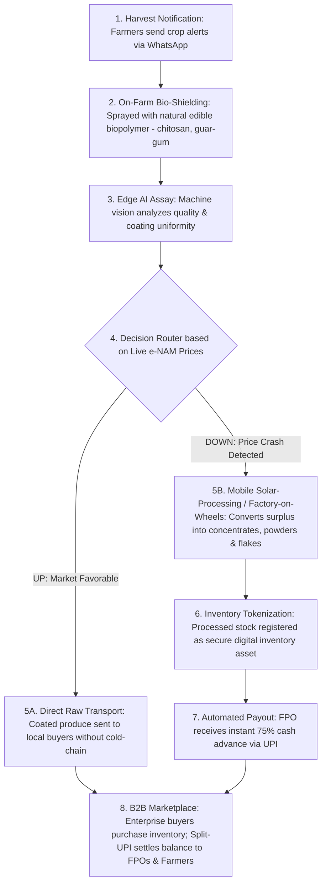

# Smart India Hackathon Workshop
# Date:31/10/2026
## Reference Number:26010266
## Name:Harish R

## Problem Title
SIH 26033: Multiple intermediaries reduce farmers earnings and increase consumer prices.

## Problem Creater's Organization
Ministry of Consumer Affairs, Food & Public Distribution

## Theme
Agriculture, FoodTech & Rural Development

## Problem Description
Expected Solution: Create a digital marketplace that:

• Connects farmers/FPOs directly with consumers and bulk buyers.
• Provides logistics support.
• Uses AI for demand forecasting and route optimization.

Benefits:

• Better prices for farmers.
• Lower prices for consumers.
• Reduced supply chain inefficiencies.

## Proposed Solution
# Detailed Explanation of the Proposed Solution
AnnaRaksha (Bio-Shield & Mobile Circular Transformation Grid) is a natural preservation and on-farm upcycling ecosystem designed for smallholder farmers and Farmer Producer Organizations (FPOs) dealing with perishable crops. Instead of relying on expensive stationary cold chains or forced distress sales during market gluts, the platform combines edible biopolymer crop coatings, edge AI quality assaying, a live e-NAM price decision router, and decentralized mobile solar-processing vans ("Factories-on-Wheels").
When farmers notify the system of an upcoming harvest via WhatsApp, crops are treated on-farm with an invisible, natural edible biopolymer spray (chitosan and guar-gum) that extends shelf life by 3x without electricity or cold storage pods. If live e-NAM market prices are favorable, the assayed raw coated produce is transported directly to local buyers without requiring a cold chain. If a price crash is detected, mobile containerized solar-processing vans travel to the village to instantly convert perishable surplus into shelf-stable concentrates, powders, and flakes. This processed stock is tokenized as a digital inventory asset, unlocking an instant 75% UPI cash advance for the FPO while enterprise buyers purchase the stable inventory on a B2B marketplace.
# How It Addresses the Problem
 * Zero-Electricity Shelf-Life Extension: Sprays harvested crops on-farm with an invisible protective layer made of natural, edible biopolymers (chitosan and guar-gum), extending crop shelf life by 3x without electricity or cold pods.
 * Eliminates Cold-Chain Logistics Costs: Enables assayed raw coated produce to be transported directly to local buyers at ambient temperatures when market prices are favorable, removing the need for refrigerated trucks.
 * Prevents Price-Crash Wastage via Mobile Upcycling: Redirects surplus crops during market downturns to containerized "Factory-on-Wheels" solar vans that travel directly to villages and convert raw perishables into shelf-stable concentrates, powders, and flakes.
 * Instant Inventory-Backed Liquidity: Registers processed stock as a secure digital inventory asset (Inventory Tokenization) and issues an automated 75% advance credit payout via UPI to the FPO before final B2B sale.
# Innovation and Uniqueness of the Solution
 * Edible Bio-Shield Preservation: Replaces capital-heavy static cold rooms with a food-grade chitosan and guar-gum micro-coating that slows respiration and microbial decay at room temperature.
 * Dynamic e-NAM Market Router: Automatically splits post-harvest supply chains based on live e-NAM price feeds—routing produce either to direct raw transport during favorable markets or to mobile solar-processing during price crashes.
 * Decentralized "Factory-on-Wheels" Upcycling: Brings containerized solar-powered dehydration, pulping, and flaking machinery directly to village clusters rather than transporting heavy, water-dense raw crops to distant processing plants.
 * Tokenized Processed-Stock Financing: Converts perishable harvests into non-perishable, verifiable digital inventory receipts that unlock instant 75% UPI credit advances and split-UPI B2B settlements.

## Technical Approach
# Technologies to Be Used
 * Conversational Interface: WhatsApp Business API for farmers to send harvest notifications and crop alerts.
 * Edge AI & Machine Vision: Smartphone-based Edge AI assay module using computer vision to analyze crop quality and verify biopolymer coating uniformity on the farm.
 * Market Intelligence & Routing Engine: Real-time integration with live e-NAM price feeds to trigger automated routing between raw dispatch and mobile upcycling.
 * Bio-Preservation & Mobile Hardware: Food-grade chitosan/guar-gum misting applicators for on-farm bio-shielding, paired with solar-powered containerized processing vans equipped with dehydrators, pulverizers, and flaking units.
 * Digital Ledger & FinTech Settlement: Blockchain/digital registry for Inventory Tokenization of processed stock, integrated with UPI rails for 75% instant advance credit and automated split-UPI B2B marketplace settlements.
Technical Architecture & Workflow Diagram

# Methodology and Process for Implementation
 * Harvest Notification: Farmers send crop readiness alerts via WhatsApp prior to harvest.
 * On-Farm Bio-Shielding: Harvested produce is sprayed on-farm with a natural, edible biopolymer solution (chitosan and guar-gum), forming an invisible protective layer that triples shelf life without electricity.
 * Edge AI Assay: A smartphone machine vision scan analyzes the produce quality and verifies coating uniformity.
 * Live e-NAM Decision Routing: The platform evaluates live e-NAM market prices to select the optimal supply chain path:
   * Path 5A (Market Favorable): Assayed raw coated produce is transported directly to local buyers without needing a cold chain.
   * Path 5B (Price Crash Detected): Surplus produce is redirected to a "Factory-on-Wheels"—a containerized solar-processing van dispatched to the village that converts the raw crop into shelf-stable concentrates, powders, and flakes.
 * Inventory Tokenization & Instant Payout: Processed shelf-stable stock is registered as a secure digital inventory asset, triggering an automated 75% advance credit payout via UPI to the FPO.
 * B2B Marketplace Settlement: Enterprise buyers purchase the stable inventory on the B2B marketplace, and a split-UPI payment settles the remaining balance directly to the FPOs and farmers

## Feasibility and Viability
# Analysis of the Feasibility of the Idea
 * Technical Feasibility: Chitosan and guar-gum coatings are FSSAI-approved, food-safe biopolymers, while Edge AI vision grading and WhatsApp chatbots run on standard rural smartphones.
 * Operational Viability: Containerized solar vans operate on a shared cluster schedule across multiple villages, avoiding idle machinery and eliminating stationary land or grid-power requirements.
 * Financial Viability: Converting crashing raw crops (e.g., ₹2/kg glut tomatoes or onions) into shelf-stable powders and flakes increases product shelf life from days to 12+ months and captures higher B2B food-processing margins.
# Potential Challenges and Mitigation Strategies
 * Coating Application Consistency: Irregular manual spraying could reduce shelf-life extension. Mitigation: Step 3 uses Edge AI machine vision specifically trained to check coating uniformity before clearing the lot for transport.
 * Working Capital Delay for Processed Goods: Shelf-stable powders and flakes may take weeks to sell in bulk to enterprise buyers. Mitigation: Inventory Tokenization (Step 6) turns the processed lot into a digital receipt that unlocks an immediate 75% UPI credit advance (Step 7).

## Impact and Benefits
 * Economic Impact: Protects farmers from mandi price crashes by transforming unsellable glut produce into high-margin, non-perishable concentrates, powders, and flakes, backed by an immediate 75% liquidity advance.
 * Operational & Social Impact: Gives village FPOs local value-addition capabilities through mobile "Factory-on-Wheels" units and frictionless WhatsApp onboarding.
 * Environmental Impact: Eliminates diesel-heavy refrigerated transport and high-energy cold storage rooms by combining zero-electricity edible biopolymer coatings with solar-powered mobile upcycling.
## Research and References
  * Edible Biopolymer Coatings (Chitosan & Guar-Gum): Composite edible coatings formulated from guar gum and chitosan create a semi-permeable barrier that reduces weight loss, slows respiration, and extends the post-harvest shelf life and bioactive quality of perishable fruits without requiring cold storage (Bhan et al., 2022; Iftikhar et al., 2022).
 * Edge AI & Machine Vision Grading: Automated computer vision and deep learning architectures classify and grade post-harvest fruit quality and surface uniformity in real time based on visual characteristics and external defects (Azadpour et al., 2025).
 * Solar Dehydration & Value-Added Upcycling: Solar drying systems dehydrate perishable agricultural produce and plant by-products while preserving physicochemical qualities and bioactive compounds, extending storage stability from days to several months (Fufa et al., 2025).
 * ICAR-CIPHET (Central Institute of Post-Harvest Engineering & Technology): National baseline study on quantitative post-harvest losses across horticulture crops in India and farm-gate agro-processing interventions (https://ciphet.icar.gov.in/).
 * National Agriculture Market (e-NAM): Pan-India electronic trading portal providing live mandi price discovery and quality assaying benchmarks for routing decisions (https://enam.gov.in/).
 * Warehousing Development and Regulatory Authority (WDRA) — e-NWR Framework: Statutory guidelines for Electronic Negotiable Warehouse Receipts (e-NWR), enabling tokenized inventory financing and instant pledge advances for Farmer Producer Organizations (FPOs) against stored shelf-stable agricultural stock (https://wdra.gov.in/).
References
Azadpour, A., Mollazade, K., Ramezani, M., & Samimi-Akhijahani, H. (2025). Automated grading of oleaster fruit using deep learning. Scientific Reports, 15. https://doi.org/10.1038/s41598-025-89358-6
Cited by: 9
Bhan, C., Asrey, R., Meena, N. K., et al. (2022). Guar gum and chitosan-based composite edible coating extends the shelf life and preserves the bioactive compounds in stored Kinnow fruits. International Journal of Biological Macromolecules, 222, 2922–2935. https://doi.org/10.1016/j.ijbiomac.2022.10.068
Cited by: 103
Fufa, D. D., Bekele, T., Tamene, A., & Bultosa, G. (2025). Drying kinetic models, thermodynamics, physicochemical qualities, and bioactive compounds of avocado (Persea americana Mill. Hass variety) seeds dried using various drying methods. Heliyon, 11, e41058. https://doi.org/10.1016/j.heliyon.2024.e41058
Cited by: 36
Iftikhar, A., Rehman, A., Usman, M., et al. (2022). Influence of guar gum and chitosan enriched with lemon peel essential oil coatings on the quality of pears. Food Science & Nutrition, 10, 2443–2454. https://doi.org/10.1002/fsn3.2851
Cited by: 53
